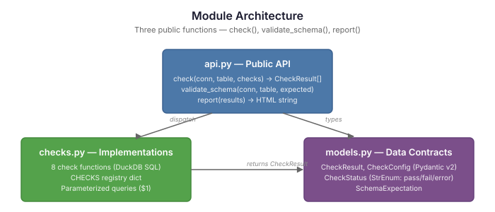
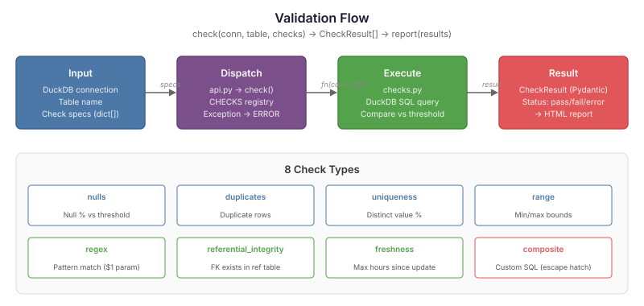

# Architecture

## Overview

A lightweight data quality library for DuckDB. Runs checks against real database connections, returns typed Pydantic results, and generates HTML reports.



## Validation Flow



## Modules

```
src/duckdb_data_quality/
├── models.py    # Pydantic models: CheckConfig, CheckResult, CheckStatus, SchemaExpectation
├── checks.py    # 8 check implementations + CHECKS registry
├── api.py       # Public API: check(), validate_schema(), report()
└── __init__.py  # Re-exports public surface
```

### models.py

Data contracts using Pydantic v2 BaseModel and Python 3.11 StrEnum:

- **CheckStatus** — pass/fail/error as StrEnum for JSON-safe serialization
- **CheckResult** — immutable result with name, table, column, status, message, value, threshold, timestamp
- **CheckConfig** — input configuration with flexible `params` dict for check-specific options
- **SchemaExpectation** — column name, expected dtype, nullable flag

### checks.py

Eight independent check functions, each `(conn, config) -> CheckResult`:

| Function | What it validates |
|----------|-------------------|
| `check_nulls` | Null percentage against a threshold |
| `check_duplicates` | Duplicate rows across specified columns |
| `check_uniqueness` | Percentage of distinct values in a column |
| `check_range` | Numeric values within min/max bounds |
| `check_regex` | String values match a pattern (parameterized `$1` query) |
| `check_referential_integrity` | Foreign key references exist in target table |
| `check_freshness` | Most recent timestamp within max hours |
| `check_composite` | Custom SQL returns an expected value |

All checks use DuckDB SQL, run against real connections, and handle edge cases (empty tables, NULLs) by returning ERROR status.

`CHECKS` dict maps names to functions for dispatch.

### api.py

Three public functions:

- **check(conn, table, checks)** — runs a list of check specs, dispatches through `CHECKS` registry, catches exceptions as ERROR results
- **validate_schema(conn, table, expected)** — compares DESCRIBE output against expected columns/types
- **report(results)** — generates a standalone HTML report table with pass/fail/error styling

## Design decisions

1. **Real DuckDB, no mocks** — all tests use in-memory DuckDB connections with deliberately imperfect data (NULLs, orphaned FKs, negative values)
2. **Pydantic for validation** — config parsing and result serialization handled by the type system, not manual checks
3. **Dict-based check specs** — `{"check": "nulls", "column": "x", "threshold": 0}` over classes, keeping the API simple for YAML/JSON config files
4. **Each check is independent** — no shared state, no ordering requirements, trivially parallelizable
5. **SQL injection awareness** — column/table names in f-strings are quoted with `"`, regex patterns use parameterized queries (`$1` placeholders). Production use should add allowlist validation for identifiers.

## Testing strategy

- **conftest.py** creates two tables with known defects: NULL email, orphaned customer_id=999, negative amount
- **test_checks.py** tests each check function directly with both passing and failing cases
- **test_api.py** tests the public API: multi-check runs, unknown checks, schema validation, report generation
- Coverage target: >90%
