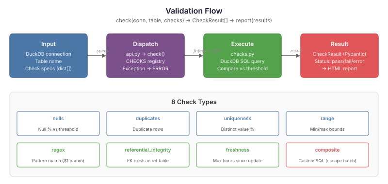
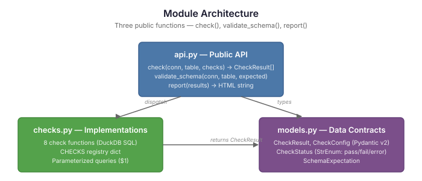

# DuckDB Data Quality

[](https://github.com/tbsvendsen/duckdb-data-quality/actions)
[](https://www.python.org/)
[](LICENSE)

Data quality checks for DuckDB databases. Simple API, real database tests,
typed Pydantic results, HTML reports. No cloud, no API keys.

## Validation Flow



## Quick Start

```python
import duckdb
from duckdb_data_quality import check, validate_schema, report

conn = duckdb.connect()

results = check(conn, "orders", [
    {"check": "nulls", "column": "order_id", "threshold": 0},
    {"check": "uniqueness", "column": "order_id"},
    {"check": "range", "column": "amount", "min": 0, "max": 100000},
    {"check": "referential_integrity", "column": "customer_id",
     "ref_table": "customers", "ref_column": "id"},
])

html = report(results)
```

## Available Checks

| Check | Description | Parameters |
|-------|-------------|------------|
| `nulls` | Null percentage per column | `threshold` (max % allowed) |
| `duplicates` | Duplicate rows | `columns` (list, optional) |
| `uniqueness` | Unique value percentage | — |
| `range` | Values within min/max bounds | `min`, `max` |
| `regex` | Pattern matching (parameterized `$1` query) | `pattern` |
| `referential_integrity` | Foreign key validation | `ref_table`, `ref_column` |
| `freshness` | Data not older than threshold | `max_hours` |
| `composite` | Custom SQL check (escape hatch) | `sql`, `expected` |

## Schema Validation

```python
result = validate_schema(conn, "orders", [
    {"column": "id", "dtype": "INTEGER"},
    {"column": "amount", "dtype": "DOUBLE"},
    {"column": "status", "dtype": "VARCHAR"},
])
```

## Architecture



```
src/duckdb_data_quality/
├── api.py       # Public API: check(), validate_schema(), report()
├── checks.py    # 8 check implementations + CHECKS registry
├── models.py    # Pydantic v2: CheckResult, CheckConfig, CheckStatus
└── __init__.py  # Re-exports public surface
```

See [ARCHITECTURE.md](ARCHITECTURE.md) for design decisions.

## Install

```bash
git clone https://github.com/tbsvendsen/duckdb-data-quality.git
cd duckdb-data-quality
python -m venv .venv && source .venv/bin/activate
pip install -e ".[dev]"
```

## Run Tests

```bash
pytest --cov
```

26 tests, 96% coverage. All tests run against real in-memory DuckDB connections.

## Tech Stack

| Component | Library |
|-----------|---------|
| Database engine | DuckDB ≥1.0 |
| Data models | Pydantic v2, StrEnum |
| Testing | pytest, mypy (strict), ruff |

## License

MIT
